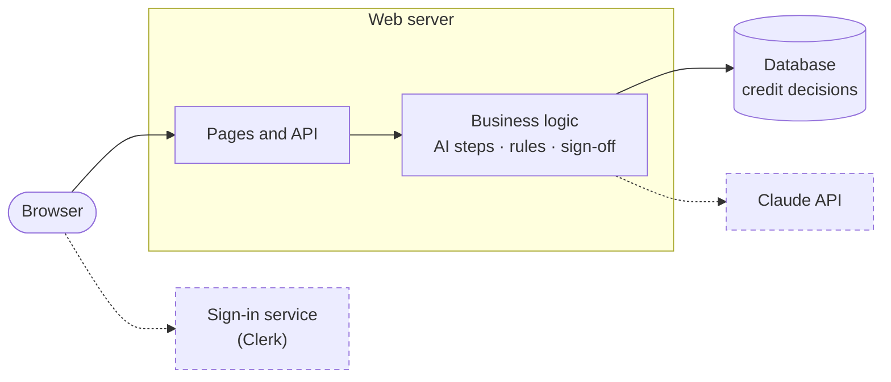
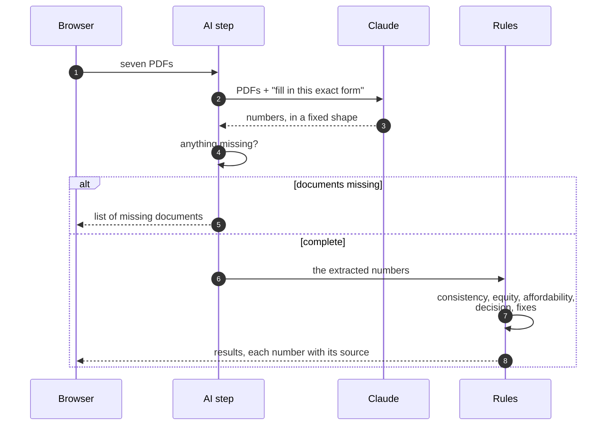

# Architecture

A high-level overview of how Hypo-Thesis is designed, and why. It's meant to be read in a few minutes, without opening the code.

## The problem

To approve a Swiss mortgage, a bank advisor reads an applicant's stack of documents (salary certificate, tax return, bank statement, pension statement, debt register, sales documentation and the application form), checks them against fixed rules, and writes a credit proposal for a credit officer to approve or reject. Much of this is copy-paste and arithmetic, and it takes days.

Hypo-Thesis does the reading and the arithmetic in under a minute, and leaves the decision with a person. It was built for a one-day exercise (Claude Build Day Zurich). The users and the workflow come from the exercise brief, not from user research.

## Design principles

The whole design follows from one idea: **AI reads, rules decide, a human signs off.**

| Who | Does what | Why |
| --- | --- | --- |
| **AI** (Claude) | Reads the PDFs and copies out the numbers. Drafts the text of the credit proposal. | Reading messy documents and writing prose is what language models are good at. |
| **Rules** (plain code) | Calculate every number and every pass or fail, from the bank's rule sheet. | A credit decision has to be correct and repeatable, and code gives the same answer every time. Language models can slip on arithmetic and vary between runs. |
| **Credit officer** (a person) | Approves or rejects, and may overrule the rules. | Accountability for a loan stays with a person. |

What a user sees that makes the output trustworthy:

- **Every number shows its source,** the document it was read from, so it can be checked by eye.
- **Missing documents are listed** before any checks run, instead of the app guessing.
- **Documents that disagree are flagged,** for example a salary that differs between the salary certificate and the tax return, or an entry in the debt register.
- **A failed application comes with a fix,** a concrete change that would make it pass: a lower price, more equity, or a co-borrower.
- **The AI-written proposal can't invent numbers.** All figures in the proposal are filled in from the rules' results (see the decisions below).
- **The officer's decision is recorded with what the rules proposed,** so an overruled decision is visible later.

## How it fits together

- **One small web server** shows the pages, answers the browser's requests and runs all the business logic. One thing to deploy, and it costs nothing while no one is using it.
- **The business logic is kept apart** from the pages, in its own package with no knowledge of the web. That's what lets the rules be tested on their own, in milliseconds.
- **The database holds one thing:** the credit officers' decisions. Applicant documents are never stored.
- **Two outside services** (dashed): Clerk handles sign-in, and Claude reads and writes. Both are reached with secret keys that live on the server, never in the code.

Built with TypeScript, React (TanStack Start), Cloudflare Workers and their D1 database, tRPC between the browser and the server, and the Anthropic SDK.

## Follow one upload

What happens when someone uploads an applicant's seven PDFs:

The key move is in steps 2–3: Claude isn't asked to judge the application. It's asked to fill in a form with a strict shape, and anything that doesn't fit the shape is rejected. From step 4 on, only the rules run. They're the same rules used for the built-in sample applicants, so an uploaded dossier and a sample one are judged identically.

## Key decisions and trade-offs

**1. Rules in code, AI only for reading and writing.**
*Why:* a decision must be explainable and identical every time. *Trade-off:* every rule is written and tested by hand.

**2. The AI's prose can't contain numbers.**
When Claude drafts the credit proposal, it writes placeholders such as `{{mortgage}}`, and the code fills in the real values. A draft with a typed-out number is thrown away and retried. *Why:* the text can never contradict the figures next to it. *Trade-off:* the writing is a little less free.

**3. Decisions are added, never edited.**
Deciding again adds a new record, and the newest one counts. Each record also stores what the rules proposed, recalculated on the server. *Why:* it's an audit trail. Who decided what, when, and whether they overruled the rules, and the browser can't fake it. *Trade-off:* the records only grow.

**4. Uploaded documents aren't kept.**
To link a decision to an upload, the server stores a fingerprint of the documents' content (a hash), not the documents. *Why:* storing personal financial documents brings legal and security duties, and avoiding them is simpler and safer. The same documents always produce the same fingerprint, so re-uploading finds earlier decisions. *Trade-off:* an upload can't be reopened later. It has to be uploaded again.

**5. If the AI is unavailable, the rest still works.**
Without an API key, upload and drafting show a clear message and the page shows a note, while the sample applicants, checks, fixes and sign-off keep working. *Why:* one missing service shouldn't take down the whole app. The live demo runs this way, to stay free.

## Where to look in the code

If you want to go deeper:

- **The rules:** [`packages/services/src/mortgage-rules.ts`](packages/services/src/mortgage-rules.ts), with its tests in [`mortgage.test.ts`](packages/services/src/mortgage.test.ts).
- **The two AI steps:** [`mortgage-extract.ts`](packages/services/src/mortgage-extract.ts) (reading the PDFs) and [`mortgage-kreditantrag.ts`](packages/services/src/mortgage-kreditantrag.ts) (drafting the proposal).
- **The page:** [`apps/web/src/routes/mortgage.tsx`](apps/web/src/routes/mortgage.tsx).
- **Setup and deploy:** the [README](README.md).
